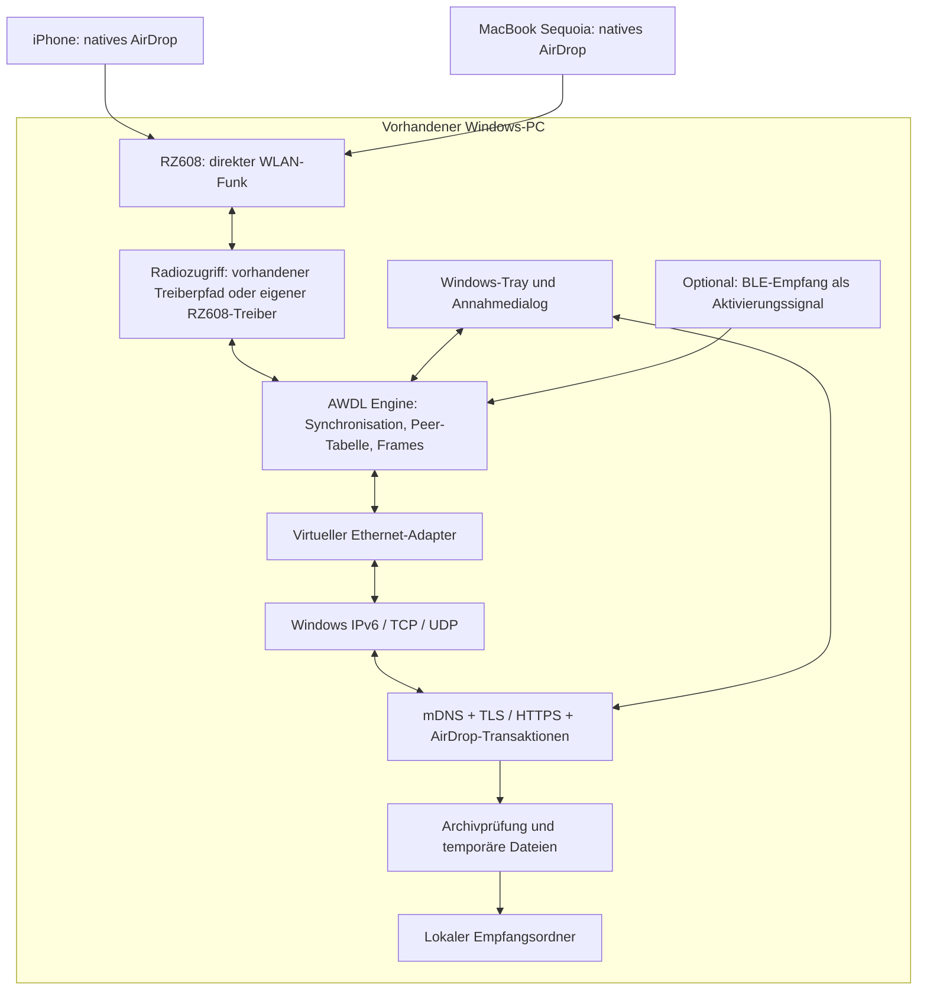
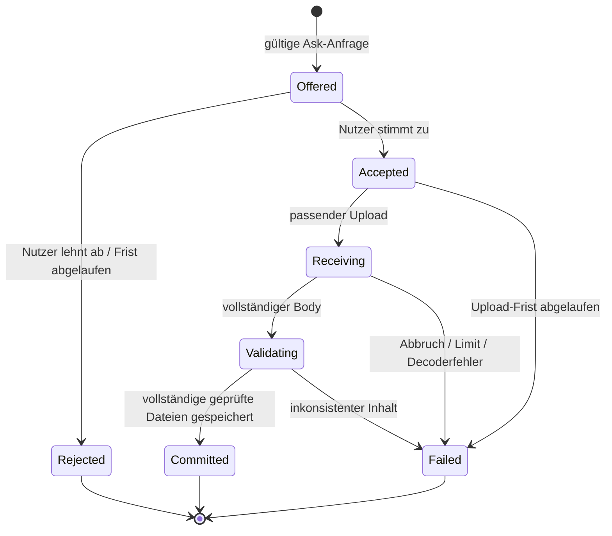

# Nativer AirDrop-Empfänger für Windows

**Zielsystem:** ein Windows-11-PC mit MediaTek RZ608. **Stand:** 17.09.2026.

**Architekturentscheidung:** Ein Windows-Prozess implementiert AirDrops Datei- und Discovery-Protokoll. Ein getrenntes Funkmodul stellt AWDL über den vorhandenen WLAN-Chip bereit. Die vorgeschlagene Software besteht vollständig aus nativen Windows-Komponenten. Der Funkpfad ist noch zu entwickeln und zu beweisen.

Dies ist eine umsetzungsorientierte Forschungsarchitektur. Eine garantierte reine App-Lösung mit dem derzeit installierten WLAN-Treiber lässt sich aus den geprüften Quellen nicht ableiten. Ebenso lässt sich daraus keine grundsätzliche Unmöglichkeit eines chipbezogenen Windows-Treibers ableiten. [Recherche und lokale Befunde](RECHERCHE.md)

## 1. Verbindliche Anforderungen

1. iPhone und MacBook senden über ihr **normales AirDrop-Menü**.
2. Ziel erscheint als beispielsweise `Windows-PC`; keine zusätzliche App oder Browserseite auf dem Sender.
3. Windows zeigt eine Annahme-/Ablehnungsabfrage und speichert angenommene Dateien lokal.
4. Kein Zusatzadapter, Raspberry Pi, Linux-/WSL-Laufzeitsystem, Mac-Relay oder Cloud-Dienst.
5. Das MacBook ist auch selbst ein unterstützter Sender. Es ist keine Infrastruktur, die für iPhone-Transfers laufen muss.
6. Erste Zielversionen sind das tatsächlich installierte aktuelle iOS und macOS Sequoia. Exakte Builds werden vor dem ersten Kompatibilitätstest erfasst.
7. Fertig bedeutet **beide Apple-Sender → Windows**. Selbsttests, OpenDrop-Kompatibilität oder nur Mac-Empfang sind Zwischenstände.

MVP-Inhalte: einzelne Dateien, Fotos als vom Sender gelieferte Dateien und Mehrfachauswahl. Links, Kontakte, Live-Photo-Zusammenhänge und andere strukturierte Freigaben werden später separat unterstützt. Bis dahin erfolgt bei nicht unterstützten Angeboten eine nachvollziehbare Ablehnung.

Keine Zusage für „Nur Kontakte“, automatisches Vertrauen innerhalb desselben Apple Accounts oder Empfang im Windows-Ruhezustand. Diese Funktionen gehören nicht zur ersten Version.

## 2. Warum dieser Aufbau

Öffentliche Projekte liefern Ansätze für AWDL und das darüberliegende AirDrop-Protokoll. Ein normales IP-Backend ist damit technisch getrennt von der Frage, ob Apple-Geräte es über den gewünschten Transport erreichen. [OpenDrop](https://github.com/seemoo-lab/opendrop), [OWL](https://github.com/seemoo-lab/owl)

Der RZ608 dieses PCs hat die PCI-ID `14C3:0608`. Der Linux-Treiber ordnet diese ID MT7921 zu. Für diese Familie existiert ein Linux-AirDrop-Bericht. **Ableitung:** Die geeignete Forschungsfrage lautet, wie die benötigten Funkfunktionen unter Windows verfügbar werden; der Markenname der Karte allein entscheidet das nicht. [Linux-Gerätetabelle](https://github.com/torvalds/linux/blob/master/drivers/net/wireless/mediatek/mt76/mt7921/pci.c), [MT7921-Projekt](https://github.com/jedbillyb/airdrop-mt7921)

Der PC nutzt derzeit Ethernet. Deshalb darf ein erster Prototyp den vorhandenen WLAN-Chip exklusiv für AirDrop verwenden. Gleichzeitige Internetverbindung über denselben WLAN-Chip ist eine spätere Erweiterung. Die Anwendung stellt nach dem Beenden dessen vorherigen Zustand wieder her.

## 3. Systemübersicht



Die Diagrammkanten zeigen den **vorgesehenen** Datenfluss. Insbesondere `RZ608 ↔ Radiozugriff` ist aktuell kein verifizierter Implementierungspfad.

## 4. Komponenten und Technologie

| Komponente | Vorschlag | Verantwortung |
|---|---|---|
| `Receiver.App` | C#, .NET 10 LTS, WPF mit Tray-Integration | Name, Empfangsfenster, Annahme, Fortschritt, Zielordner |
| `Receiver.Host` | C#, .NET 10, Kestrel | HTTPS, Discovery, Transaktionen; regulärer Benutzerprozess |
| `Receiver.Protocol` | C#-Bibliothek, unabhängig von UI/Netzwerk | Begrenzte plist-/DVZip-/CPIO-Verarbeitung, Inhaltsmodell |
| `Awdl.Engine` | Rust, eigener Prozess | Plattformunabhängige AWDL-Logik und Frame-Verarbeitung |
| `Radio.Helper` | Kleiner Windows-Dienst | Privilegierter Gerätezugriff, Puffer, Konfiguration und Wiederherstellung |
| `Radio.Rz608` | Nur falls erforderlich: C/C++, WDK/KMDF | Native Kontrolle des PCIe-WLAN-Geräts, RX/TX und Firmware-Kommandos |
| `VirtualLink` | Vorhandener signierter TAP-Treiber als erster Kandidat | Ethernet-Frames zwischen Windows-IP-Stack und AWDL-Engine |
| `Receiver.Diagnostics` | CLI | Fähigkeiten, Nachweise, strukturierte Fehler, kompatible Versionen |

Der konkrete .NET-SDK-Stand, Rust-Toolchain, WDK und alle Bibliotheken werden beim Implementierungsstart festgeschrieben. .NET 10 ist zum Recherchedatum LTS. [Microsoft-Supportpolitik](https://dotnet.microsoft.com/en-us/platform/support/policy)

Bewährte HTTP-/TLS-Bibliotheken verwenden. Kein neuer HTTP-Parser aus Lernzwecken. WinDrop kann als Windows-Codebasis geprüft werden, aber sein selbst entwickelter Stack ist keine ungeprüfte Produktionsabhängigkeit. Für AWDL werden portable Teile vorhandener Referenzen bewertet; Linux-Netlink-Aufrufe können nicht unverändert unter Windows laufen.

## 5. Der kritische Pfad: Radiozugriff

### 5.1 Vorhandenen Treiberpfad zuerst prüfen

Der Untersuchungsplan trennt diese Fähigkeiten ausdrücklich:

| Fähigkeit | Erforderlicher Nachweis |
|---|---|
| Raw RX | Tatsächlich empfangene 802.11-Management- und Datenframes mit brauchbaren Metadaten |
| Raw TX | Gesendete AWDL-relevante Framearten werden auf dem vorhandenen Mac beobachtet oder bewirken eine eindeutige Antwort des Peers |
| Kanalsteuerung | Angeforderte Frequenz wird erreicht; Umschaltverzögerung und Fehler werden gemessen |
| Zeitbasis | Zusammenhang von Hardwarezeitstempel und monotoner Windows-Zeit ist bekannt; Jitter wird protokolliert |
| Unicast/ACK | Empfangene Unicastframes werden ausreichend zuverlässig bestätigt; Wiederholungen werden erkannt |
| MAC-Adressierung | Für AWDL notwendige Adressen/Framefelder können gesetzt und empfangen werden |
| Lebenszyklus | Reset, Stop und Sleep/Resume geben das Gerät zuverlässig frei |

Npcap ist zunächst ein Diagnosekandidat. Die aktuelle Installation ist nicht mit Raw-802.11-Support konfiguriert. Eine entsprechende Konfiguration kann die Untersuchung ermöglichen; sie garantiert weder Monitorfähigkeit des Herstellertreibers noch Funk-Injection. Ein erfolgreiches `pcap_sendpacket` oder eine lokal mitgeschnittene Kopie ist kein Übertragungsnachweis. [Npcap-Dokumentation](https://npcap.com/guide/npcap-devguide.html), [offenes Injection-Issue](https://github.com/nmap/npcap/issues/85)

Zuerst dokumentierte Windows-/Herstellerschnittstellen und verfügbare signierte OEM-Treiber prüfen. Änderungen immer mit dokumentiertem Ausgangszustand und Wiederherstellung. Keine frei erfundenen Vendor-IOCTLs; keine Annahme, die vorhandene IHV-Erweiterung biete die benötigten Funktionen.

### 5.2 Falls der Herstellertreiber den Pfad nicht anbietet

Dann entsteht ein eigenständiges **RZ608-Treiberprojekt**, kein weiterer GUI- oder Socket-Workaround.

Vorgeschlagener Umfang eines minimalen nativen Radio-Treibers:

1. Ausschließliche Geräteübernahme für die bekannte PCI-ID und Revision; kein gleichzeitiger Zugriff mit dem Herstellertreiber.
2. PCIe-Ressourcen, Interrupts, DMA-Puffer und Ringverwaltung.
3. Geräteinitialisierung, notwendiges Firmwareladen, Kalibrierungsdaten und MCU-Kommandos.
4. Frequenz-/Kanalsteuerung unter Beachtung der am Gerät geltenden Funkrestriktionen.
5. RX-Filter, Frame-Metadaten und Hardwarezeitstempel.
6. TX-Deskriptoren für die benötigten AWDL-Framearten, Status und Abbruch.
7. Hardware-/Firmwareunterstützung für zeitkritische Bestätigung und gegebenenfalls geplante Übertragung.
8. Fehlerbehandlung, Stromzustände, Reset und Rückkehr zum normalen WLAN-Treiber.

Linux `mt76/mt7921` dient als Referenz für Geräteverhalten. Seine Kernelabstraktionen, Firmwareverfügbarkeit und Lizenzbedingungen sind ausdrücklich Teil der Portierungsanalyse. Ein vollständiger WLAN-Infrastrukturtreiber ist für den exklusiven ersten Versuch nicht automatisch erforderlich; der notwendige Rohfunkpfad kann dennoch sehr umfangreich sein.

Ein NDIS-Filter allein ergänzt keine vom Miniport oder von der Firmware verweigerten Funkoperationen. [Microsoft: Treiberschichten](https://learn.microsoft.com/en-us/windows-hardware/drivers/network/power-management--ndis-6-30-)

**Entscheidungspunkt:** Gibt es weder einen funktionierenden vorhandenen Treiberpfad noch einen belegbaren Weg zu RX/TX mit einem eigenen Treiber, bleibt das Produktziel offen. Der Ergebnisbericht nennt die konkrete fehlende Funktion und die durchgeführten Versuche. Er ersetzt das Ziel nicht durch eine Linux-Bridge.

### 5.3 Schnittstelle des Funkmoduls

Die folgende Schnittstelle ist **neu zu implementierendes Design**, keine existierende Windows-API:

```text
IRadioTransport
  probe() -> CapabilityReport
  acquire(adapterId, exclusive) -> RadioSession
  configure(session, channel, localMac, receiveFilter) -> AppliedConfig
  receive(session) -> stream<RadioFrame>
  submit(session, frames, optionalDeadline) -> TxReceipt
  stop(session) -> RestoreResult

CapabilityReport
  adapterId, driverVersion, firmwareVersion?
  rawRx, rawTxAction, rawTxData, channelControl, hardwareAck, timestampSource
  each capability: unknown | unsupported | reported | verified
  evidenceIds[], limitations[]

RadioFrame
  frameBytes, channel, rssi?, hardwareTimestamp?, monotonicTimestamp
  fcsState, captureFlags
```

`TxReceipt` unterscheidet „vom Treiber angenommen“, „Hardwareabschluss“ und „Peerantwort nachgewiesen“. Die UI darf daraus nicht dieselbe Erfolgsmeldung machen.

Steuerung über zugriffsbeschränkte Named Pipes; bei Bedarf Daten über begrenzte Shared-Memory-Ringe. Versionsnummern, Größenprüfung, Backpressure und Abbruch gehören zum Vertrag. Nur der Dienst öffnet privilegierte Gerätehandles. HTTP, Archive und Dateinamen werden nie im Kernel verarbeitet.

## 6. AWDL und virtuelle Netzwerkschnittstelle

`Awdl.Engine` verwaltet Peer-Erkennung, Synchronisation, Verfügbarkeitsfenster, Wahl/Synchronisationsbeziehungen, Kanalplan, Frame-Kapselung, Sequenznummern und Duplikate. OWL und die Rust-Neuimplementierung sind Ausgangspunkte für die Protokollarbeit. Die exakten Formate werden aus fixierten Quellen und eigenen Mitschnitten übernommen, nicht aus ausgedachten Paketlayouts. [OWL](https://github.com/seemoo-lab/owl), [opendrop-rs](https://github.com/ayourtch-llm/opendrop-rs)

Der MVP darf AWDL dauerhaft während eines expliziten Empfangsfensters betreiben. Dadurch ist BLE-Aussenden kein ungeprüfter Pflichtbaustein. Ein späterer BLE-Watcher kann den Empfang aktiver Sender erkennen und Energie sparen. Keine Kontakt-Hashes sammeln oder in Nutzeridentitäten auflösen.

Zeitkritische Funkbestätigungen gehören in Hardware/Firmware. Ein Windows-Userspace-Timer ist kein Ersatz für MAC-ACK-Timing. Der Kanalplan verwendet eine monotone Zeitbasis; Hardwarezeit und Hostzeit werden abgeglichen. Ein dauerhaft fester Kanal ist nur ein Diagnoseversuch, solange reale Sender damit nicht stabil funktionieren.

Die AWDL-Engine verbindet Ethernet-Frames mit einer eigenen virtuellen Ethernet-Schnittstelle, beispielsweise `AirDrop Link`. Darauf laufen Windows-IPv6, Neighbor Discovery, UDP/mDNS und TCP. Als Startpunkt ist ein signiertes TAP-Paket zu prüfen. [tap-windows6](https://github.com/OpenVPN/tap-windows6)

Für diesen Adapter gelten:

- Eigene Link-Local-IPv6-Adresse, korrektes Interface-Scoping und kontrollierte MTU.
- Kein Default Gateway, keine Internetfreigabe und keine Weiterleitung zwischen Ethernet und AWDL.
- Nur notwendige IPv6-Nachbarschafts-/Multicastfunktionen und AirDrop-Verkehr; keine SMB-Freigabe des Windows-PCs auf dem neuen Link.
- Änderungen an Firewall und Adapter beziehen sich ausschließlich auf die neue Schnittstelle und werden beim Entfernen zurückgenommen.
- Stabile Zuordnung von AWDL-Peer, Ethernet-Adresse und IPv6-Ziel; Multicast darf nicht wie Unicast behandelt werden.

Wintun wäre eine mögliche alternative L3-Anbindung mit zusätzlicher Mapping- und Nachbarschaftslogik. Es wird für den ersten Entwurf nicht gewählt. Weder TAP noch TUN ermöglichen für sich den Zugriff auf den physischen WLAN-Funk.

## 7. AirDrop-Anwendungsschicht

### 7.1 Discovery und Profile

Auf dem verifizierten Link wird `_airdrop._tcp.local.` über mDNS/DNS-SD veröffentlicht. PTR, SRV, TXT und IPv6-Adresse gehören konsistent zusammen. Der tatsächlich verwendete HTTPS-Port steht im SRV-Record; eine in Referenzprogrammen verwendete Portnummer ist keine universelle Protokollkonstante.

Gerätename, Modellbeschreibung und beworbene Fähigkeiten stammen aus einem expliziten Profil. Das Profil enthält Quellenstand, getestete Senderbuilds, benötigte Felder, Archivvarianten und bekannte Grenzen. Es werden nur implementierte Fähigkeiten angeboten. Keine Apple-Account-Identität vortäuschen.

Protokollreferenz für den ersten vertikalen Durchstich: [beobachteter Discover/Ask/Upload-Ablauf](https://github.com/ayourtch-llm/opendrop-rs/blob/main/docs/airdrop-protocol.md). Wiederholte Ankündigungen müssen Linkwechsel und Paketverlust berücksichtigen; keine Neustartschleife, die laufende Transfers unterbricht.

### 7.2 TLS und Anfrageverarbeitung

Der HTTPS-Server nutzt eine lokale Identität und eine getestete AirDrop-TLS-Konfiguration. Selbstsignierte Empfängeridentitäten sind ein durch Referenzprojekte berichteter Interoperabilitätspfad, jedoch für die konkrete iOS-Version nachzuweisen. Eine erfolgreiche TLS-Verbindung beweist keine Apple-Account-Identität des Senders.

Zertifikate und Schlüssel bleiben im Benutzerkontext geschützt. Etwaige AirDrop-spezifische Akzeptanz fremder Zertifikate wird auf diesen Listener begrenzt; niemals globale Zertifikatsprüfung für die Anwendung ausschalten. „Nur Kontakte“ wird nicht durch kopierte Apple-Account-Schlüssel nachgebildet.

HTTP-Verarbeitung unterstützt begrenzte Header, Request-Body-Limits, Chunked Transfer, Keep-alive, parallele Verbindungen und `Expect: 100-continue`. Fehlerhafte oder widersprüchliche Framing-Angaben werden abgewiesen. Eine wartende Annahme darf Discovery und andere Verbindungen nicht blockieren.

Property Lists werden mit Grenzen für Größe, Tiefe und Objektanzahl geparst. HTTP transportiert Apples tatsächlich erwartete Formate; JSON wird nur für eigene Diagnose-/IPC-Verträge verwendet.

### 7.3 Transaktionszustand



`/Discover` ist noch kein Transfer und löst keine Annahme aus. `/Ask` erzeugt das Angebot mit Dateiliste und gemeldeten Senderinformationen. Eine positive Antwort folgt erst nach lokaler Annahme. `/Upload` benötigt einen passenden angenommenen, nicht verbrauchten Transfer.

Die Bindung berücksichtigt AirDrops tatsächlich übermittelte Transferkennung, Link-/Peer-Kontext und die beobachtete TLS-Verbindungssemantik. Es darf kein eigener Token erfunden werden, den der unveränderte Apple-Sender anschließend zurückgeben müsste. Wenn ein Profil keine sichere Zuordnung über mehrere Verbindungen erlaubt, darf diese nicht durch blindes Matching auf Anzeigename ersetzt werden. Fehlende Bindung wird als offene Protokollfrage behandelt.

Anzeigenamen sind nicht verifizierte Identitäten. Annahme gilt für genau diesen Transfer, nicht für alle künftigen Transfers vom selben Namen. Replays, Upload vor Annahme, Upload nach Ablehnung und konkurrierende Wiederverwendung derselben Transaktion werden abgewiesen.

### 7.4 Dateiannahme und Abschluss

Der Empfänger streamt in ein privates temporäres Verzeichnis auf demselben Volume wie der Zielordner. DVZip-Dekodierung und CPIO-Verarbeitung sind unabhängig testbare Module. Komprimierte und unkomprimierte DVZip-Blöcke sowie tatsächlich beobachtete Archivvarianten werden durch Testdaten abgedeckt. [iOS-26-Patchnotizen](https://github.com/jedbillyb/airdrop-mt7921/blob/main/patches/README.md)

Erste konfigurierbare Grenzen: 1 MiB Metadaten, 100 Dateien, 4 GiB entpackte Gesamtdaten und begrenzte Dekompression pro Block. Die Werte sind Produktentscheidungen, keine Eigenschaften des Apple-Protokolls. Speicherverbrauch darf nicht proportional zur gesamten Uploadgröße wachsen.

Die Ablage verhindert Pfadüberschreitung, absolute Pfade, Laufwerks-/UNC-Pfade, NTFS-Streams, reservierte Windows-Namen, Links/Reparse Points und Kollisionen durch Groß-/Kleinschreibung. Dateinamen werden geprüft und nötigenfalls nachvollziehbar umbenannt. Dateien werden nie automatisch ausgeführt oder geöffnet.

Jeder Transfer erhält einen eigenen Unterordner. Erst nach vollständigem Empfang, Prüfung und erfolgreichem Schreiben wird das temporäre Verzeichnis auf demselben Volume als abgeschlossener Transfer veröffentlicht. Fehler oder Abbruch erzeugen keinen scheinbar erfolgreichen Teiltransfer.

Eine positive finale Upload-Antwort bedeutet, dass die Daten vollständig geprüft und lokal abgeschlossen sind. Ein Wiederholungsversuch nach verloren gegangener Antwort muss denselben abgeschlossenen Transfer erkennen, statt vorhandene Dateien zu überschreiben. Eine Wiederaufnahme ab beliebigem Byte wird ohne Protokollnachweis nicht versprochen.

## 8. Oberfläche und Betrieb

Der erste Empfänger läuft als Benutzerprozess mit Tray-Symbol. Der getrennte Dienst wird nur für notwendige Funk-/Adapteroperationen privilegiert. Bei nicht angemeldetem Benutzer oder fehlendem Annahmedialog ist der MVP nicht empfangsbereit.

Der Nutzer sieht:

1. „Empfang für 10 Minuten aktivieren“.
2. Status „Vorbereitung“, „Empfangsbereit“ oder eine konkrete Störung.
3. Ein Angebot mit Sendername, Dateiarten, Dateianzahl und bekannter Größe; bei nicht verifizierter Identität entsprechende Kennzeichnung.
4. „Annehmen“ / „Ablehnen“, anschließend Fortschritt und Zielordner.

„Empfangsbereit“ setzt einen funktionsfähigen Link, Listener und Discovery voraus. Funkzugriff nicht möglich, Signierung ausstehend und nicht getestete iOS-Kompatibilität sind eigene Diagnosezustände. Eine grüne UI allein ist kein Testbeleg.

Sleep oder Adapterverlust brechen laufende Transfers geordnet ab. Nach Resume erfolgen erneuter Fähigkeitstest, Linkaufbau und Ankündigung. Ein watchdog-gestütztes Lease verhindert, dass ein abgestürzter Prozess den normalen WLAN-Zustand dauerhaft blockiert.

## 9. Alternative Transportversuche innerhalb der Vorgaben

### Begrenzter LAN-Versuch

Ein kleiner Windows-Listener kann das AirDrop-Angebot im vorhandenen lokalen Netzwerk veröffentlichen. Erfolg erfordert, dass **unverändertes iPhone und unveränderter Mac** das Ziel erkennen und eine Datei übertragen. Der negative historische Bericht macht dies zu einem begrenzten Versuch, nicht zur vorausgesetzten Lösung. [Originalbeobachtung](https://bakedbean.org.uk/posts/2021-05-airdrop-anywhere-part-1/)

Der Versuch verwendet normale Senderaktionen und nachvollziehbare Netzwerkbeobachtung. Ein künstlicher HTTP-Aufruf zum Windows-Server ist nur ein Servertest. Eine spezielle Finder-Einstellung kann separat Diagnoseinformationen liefern, ist aber kein Nachweis für den unveränderten iPhone-Pfad.

### Neuere Standard-/Herstellerpfade

Wenn eine aktuelle dokumentierte Windows- oder Herstellerschnittstelle einen neuen AirDrop-kompatiblen Weg bietet, erhält sie ein eigenes Transportbackend und denselben Apple-End-to-End-Test. Aus Googles Android-Interoperabilität oder Apples Wi-Fi-Aware-Framework wird keine Windows-Funktion hergeleitet. [Google](https://support.google.com/android/answer/9286773?hl=en), [Apple](https://developer.apple.com/videos/play/wwdc2025/228/)

## 10. Bauphasen und Abnahme

| Phase | Ergebnis | Bestehensbedingung |
|---|---|---|
| P0: Ausgangslage | Versions-/Hardwarebericht, gepinnte Quellen, Diagnose-CLI | Exakte Builds erfasst oder ausdrücklich als noch fehlend markiert; keine erfundene Kompatibilität |
| P1: Transport | Vorhandener Treiberpfad oder RZ608-Treiber-Prototyp; begrenzter LAN-Versuch | Tatsächliches bidirektionales AWDL-relevantes RX/TX und Kanalsteuerung; alternativ nativer LAN-AirDrop-Erfolg von beiden Sendern |
| P2: AWDL-Link | Windows–Apple-Link mit stabiler Zeitbasis und IPv6 | Mindestens 10 Minuten wiederholbare Peer-/IPv6-Kommunikation; echte Peerantworten statt lokaler Echos |
| P3: Kleiner Transfer | Minimaler Discover/Ask/Upload-Empfänger | Je eine bekannte Datei vom iPhone und vom Sequoia-Mac kommt vollständig an |
| P4: Empfangsqualität | Annahme, Streaming, Multi-Dateien, sichere Ablage | Positive und negative Fälle der Testmatrix erfüllt |
| P5: Windows-App | Tray, Wiederherstellung, Diagnose, Paketierung | Wiederholbarer Start/Stop/Resume; erforderliche Treiber in nutzbar signierter Form |

Für P1 zuerst ungefähr ein bis zwei Entwicklungstage zur **Eingrenzung** des vorhandenen Treiberpfads planen. Das ist eine Planungsgröße, keine Frist, nach der Unmöglichkeit feststeht. Ein eigener WLAN-Treiber ist ein separates Vorhaben von möglicherweise Wochen bis Monaten mit offenem Ausgang. Für P2/P3 hängt der Aufwand wesentlich von P1 und den konkreten Senderbuilds ab.

Nach jeder Phase enthält ein Bericht: Artefakte, ausgeführte Kommandos, Versionsstände, beobachtete Resultate und noch fehlende Nachweise. Bei einem Hindernis wird am konkret offenen Teil weitergearbeitet; unabhängige Codec-/Sicherheitstests dürfen parallel im Arbeitsablauf entstehen. Der Schwerpunkt bleibt auf dem kritischen Transportnachweis.

### Testmatrix

| Bereich | Fälle und Erfolgskriterium |
|---|---|
| Apple-Interoperabilität | iPhone und Mac getrennt; Name sichtbar, Annahme, vollständige Datei; genaue Builds im Bericht |
| Ohne Vermittler | iPhone → PC bei ausgeschaltetem Mac; PC benötigt keinen Linux-Prozess oder externen Dienst |
| Offline | AWDL-Hauptpfad ohne Internetzugang und ohne gemeinsamen Access Point prüfen |
| Integrität | Bekannte Dateien aus Dateien/Finder mit SHA-256 vergleichen; mögliche Foto-Konvertierung des Senders separat behandeln |
| Umfang | Leere Datei, kleines Dokument, Foto, mehrere Dateien, 100 MiB; danach 1 GiB als Belastungstest |
| Zustimmung | Ablehnung, Timeout, Upload ohne Ask, nach Ablehnung, doppelte IDs, verspätete Uploads |
| Parser | Beschädigte plist, Framing-Konflikte, DVZip-Stored-Blöcke, kaputte Kompression, CPIO-Varianten und Größenabweichungen |
| Dateisystem | `../`, absolute Pfade, UNC, `name:stream`, reservierte Namen, casefold-Kollisionen, Links, voller Datenträger |
| Betrieb | Funkverlust, Prozessabbruch, Start/Stop, Sleep/Resume, zwei gleichzeitige Sender |
| Dauerlauf | Je Sender 20 kleine Transfers; Erfolgsquote, Discoveryzeit und Durchsatz als Messwerte dokumentieren |

Codec-Tests verwenden unabhängige Referenzen und zulässig gewonnene reale Fixtures. Ein Roundtrip durch denselben eigenen Encoder und Decoder reicht nicht. Alle hardwareabhängigen Tests bleiben bis zur realen Durchführung `NOT_RUN`.

## 11. Paketierung, Signierung und Wartung

Die Anwendung kann regulär installiert und beim Benutzerlogin gestartet werden. Ein nativer Radio- oder TAP-Treiber benötigt einen passenden Installations- und Signierungsweg. Ein fertiger Build ohne ladbares Treiberpaket erfüllt P5 nicht. [Microsoft-Signierungsrichtlinie](https://learn.microsoft.com/en-us/windows-hardware/drivers/install/kernel-mode-code-signing-policy--windows-vista-and-later-)

Produktbetrieb darf kein pauschales Abschalten von Secure Boot, Treibersignaturprüfung oder Smart App Control voraussetzen. Wenn ein Entwicklungsexperiment besondere Systemeinstellungen erfordert, wird das gesondert als Experiment mit konkretem Eingriff dokumentiert; es wird nicht als fertige Installation ausgegeben.

Jede Apple- oder WLAN-Treiberaktualisierung kann eine erneute Kompatibilitätsprüfung auslösen. Protokollprofile, Radio-Treiber und UI werden deshalb getrennt versioniert. Diagnoseprotokolle enthalten standardmäßig keine Dateiinhalte, Kontakt-Hashes oder TLS-Schlüssel. Detaillierte Mitschnitte werden nur gezielt für einen Test erzeugt und bleiben lokal.

## 12. Vorgeschlagene Repository-Struktur

```text
src/
  Receiver.App/
  Receiver.Host/
  Receiver.Protocol/
  Receiver.Diagnostics/
native/
  awdl-engine/
  radio-helper/
  radio-rz608/             # entsteht nur bei belegtem Bedarf
  virtual-link/
contracts/
  radio-v1.md
  receiver-events-v1.schema.json
tests/
  protocol/
  interoperability/
  filesystem/
  fixtures/               # künstliche oder freigegebene Testdateien
tools/
  collect-capabilities.ps1
  run-compatibility.ps1
docs/
  decisions/
  compatibility-matrix.md
  protocol-profiles/
evidence/
  hardware.json
  research-pins.json
  runs/                   # Resultate tatsächlicher späterer Tests
```

Diese Struktur ist der Bauplan. Die Anwendung und die Treiber wurden im Rahmen dieses Architekturauftrags noch nicht implementiert.
